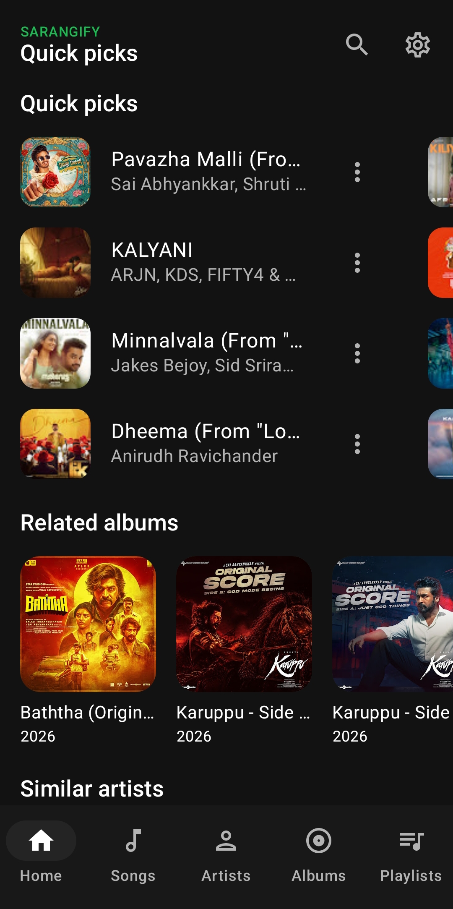
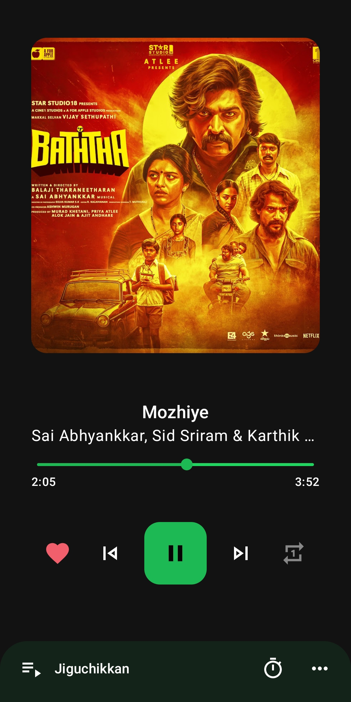
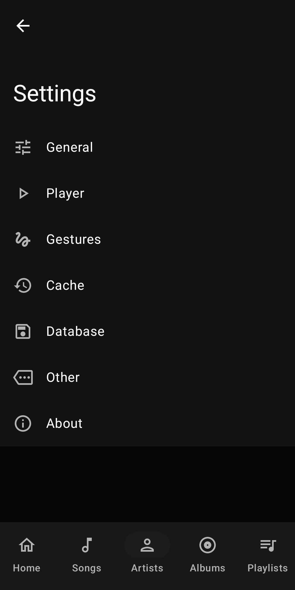
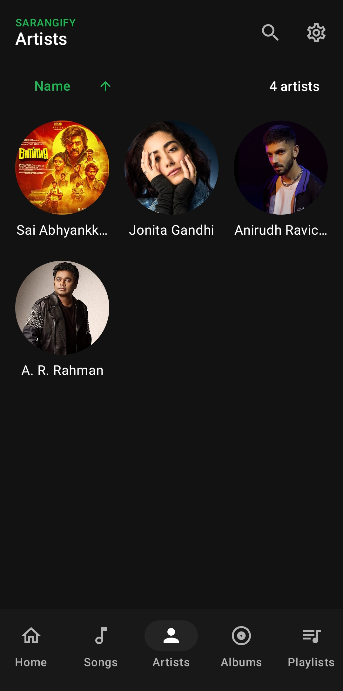

<p align="center">
  
</p>

<h1 align="center">SARANGIFY</h1>

<p align="center">Aesthetic YouTube Music Client for Android</p>

<p align="center">
  <a href="LICENSE"></a>
  <a href="https://developer.android.com/"></a>
  <a href="https://kotlinlang.org/"></a>
  <a href="https://github.com/saranghaeyong/sarangify"></a>
</p>

<p align="center">
  A community-driven Android music player for discovering and playing music through YouTube Music, with an offline-capable library and a focused listening experience.
</p>

<p align="center">
  <a href="#features">Features</a> ·
  <a href="#screenshots">Screenshots</a> ·
  <a href="#download">Download</a> ·
  <a href="#build-from-source">Build</a> ·
  <a href="#contributing">Contributing</a> ·
  <a href="#support">Support</a> ·
  <a href="#disclaimer">Disclaimer</a>
</p>

<a id="features"></a>
## 🎧 Features

### Playback

- Search YouTube Music and stream tracks.
- Keep music playing in the background with a persistent queue and media controls.
- Manage the playback queue and create local playlists.
- Cache tracks for offline playback.
- Set a sleep timer, skip silence, and enable loudness normalization.

### Library and discovery

- Browse songs, albums, artists, and playlists.
- Like songs and bookmark artists and albums.
- Keep local playlists and a listening history.
- Open supported YouTube and YouTube Music links in SARANGIFY.

### Lyrics and experience

- View timed or unsynchronized lyrics and edit lyrics in the app.
- Use the dark interface built with Material 3.
- Choose from the available interface languages: English, Spanish, German, French, Italian, Russian, and Turkish.

### Android integration

- Control playback from the Android media session and notification.
- Use Android Auto support, which can be enabled in the app's settings.

<a id="screenshots"></a>
## 📱 Screenshots

| Home | Player | Albums |
| --- | --- | --- |
| <br>Home and quick picks | <br>Now playing | <br>Albums |

| Artists | Artist | Songs |
| --- | --- | --- |
| <br>Artists | <br>Artist detail | <br>Songs |

<a id="download"></a>
## ⬇️ Download

Visit [SARANGIFY GitHub Releases](https://github.com/saranghaeyong/sarangify/releases) to check for Android APKs. Releases and installable APKs are provided only when published there; no production-signed APK is promised by this repository.

To install an APK downloaded from Releases:

1. Download the APK to your Android device.
2. If Android prompts you, allow your browser or file manager to install unknown apps.
3. Open the downloaded APK and follow Android's installation prompts.

Debug APKs built from source are intended for testing, not as production releases. You can also [build SARANGIFY yourself](#build-from-source).

<a id="build-from-source"></a>
## 🛠️ Build from source

### Requirements

- JDK 17 or newer.
- Android SDK with the API 37 platform at minor API level 2, as required by the app configuration.
- Android SDK command-line tools and the SDK components requested by Gradle.
- The checked-in Gradle Wrapper uses Gradle 9.8.1 and the project uses Android Gradle Plugin 9.4.1.

Set `ANDROID_HOME` or `ANDROID_SDK_ROOT` to your Android SDK location if it is not already configured. From the repository root, run:

```sh
./gradlew assembleDebug
```

Gradle will download the configured Gradle distribution and resolve the project's build dependencies. The debug APK is written to:

```text
app/build/outputs/apk/debug/app-debug.apk
```

If you build more than one variant, look under `app/build/outputs/apk/` for the corresponding APK.

<a id="contributing"></a>
## 🤝 Contributing

Contributions are welcome. Please read [CONTRIBUTING.md](CONTRIBUTING.md) before opening a pull request, and follow the expectations in [CODE_OF_CONDUCT.md](CODE_OF_CONDUCT.md).

<a id="support"></a>
## 💬 Support

For a bug report or project question, open a [GitHub issue](https://github.com/saranghaeyong/sarangify/issues). Include relevant device and Android-version details, steps to reproduce, and logs only after removing personal or sensitive information.

<a id="disclaimer"></a>
## ⚖️ Disclaimer

SARANGIFY is an independent, community-driven project. It is not affiliated with, endorsed by, or sponsored by YouTube or Google. YouTube, YouTube Music, Google, Android, and other third-party names and marks belong to their respective owners.

SARANGIFY relies on third-party services for some music search, metadata, and playback functions. Those services may change or become unavailable. Users are responsible for complying with applicable laws and the terms and policies of any services they use. This project does not promise unrestricted access, ad blocking, or uninterrupted service.

## 📄 License

SARANGIFY is distributed under the [GNU General Public License v3.0](LICENSE). Preserve the existing license and applicable original attribution notices when redistributing or modifying the project.
